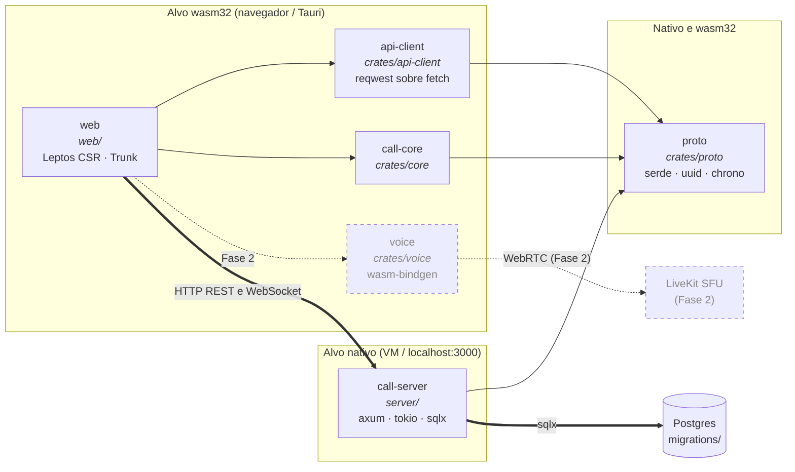

# Crates do workspace

O `proto` é o contrato: é o único crate compilado para os dois alvos, então uma mudança nele
quebra a compilação do lado que ficou para trás. O áudio nunca passa pelo `call-server`.

Legenda: as setas finas são dependências no `Cargo.toml`, as grossas são chamadas em tempo de
execução e as tracejadas ainda não existem.

| Crate | Depende de | O que tem hoje |
| --- | --- | --- |
| `proto` | `serde`, `uuid`, `chrono` | Health, auth, servidores, canais e mensagens (DTOs e validação), erros, IDs tipados e envelope WS |
| `call-server` | `proto`, `axum`, `sqlx`, `tokio`, `argon2`, `jsonwebtoken` | `/health`, `/auth/*`, `/users/@me`, servidores, canais, convites e mensagens, WebSocket (`/ws`), CORS e migrations |
| `api-client` | `proto`, `reqwest`, `gloo-net` | Todas as rotas REST, refresh automático e o WebSocket |
| `call-core` | `proto` | `MessageLog`, `Typing`, `Backoff` e `ConnState` |
| `voice` | `wasm-bindgen`, `serde` | Ponte com o `livekit-client` JS: `VoiceRoom` e `VoiceEvent` ([09-voz.md](09-voz.md)) |
| `web` | `api-client`, `call-core`, `leptos` | Login, servidores, canais, chat em tempo real e reconexão ([08-client.md](08-client.md)) |
