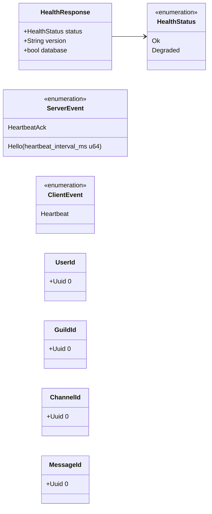
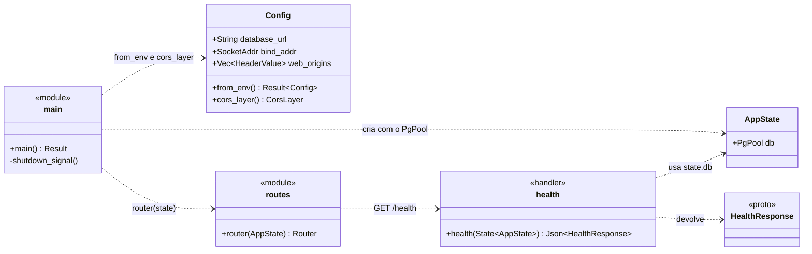
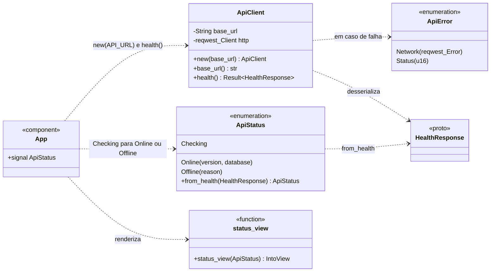

# Tipos e funções

## Contrato (`proto`)

- **`ServerEvent` e `ClientEvent`** são serializados como `{"t": "HELLO", "d": {...}}`, com
  testes em `crates/proto/src/ws.rs`. O servidor ainda não tem handler de WebSocket que os use.
- **IDs tipados** (`UserId`, `GuildId`, `ChannelId`, `MessageId`) saem da macro `id_type!`: cada
  um embrulha um `Uuid` com `From<Uuid>`, `Display` e `serde(transparent)`. Assim o compilador
  impede passar um `ChannelId` onde se espera um `UserId`. Ainda não são usados.

## Servidor (`call-server`)

## Client (`api-client`, `call-core`, `web`)

A constante `API_URL`, em `web/src/main.rs`, vem da variável `CALL_API_URL` na hora do build.
Sem ela, aponta para `http://127.0.0.1:3000`.
