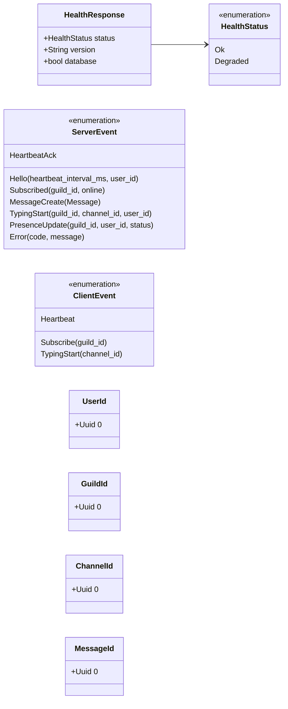
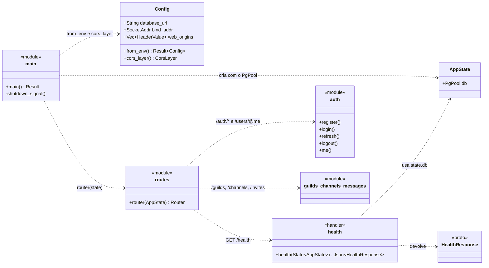

# Tipos e funções

## Contrato (`proto`)

- **`ServerEvent` e `ClientEvent`** são serializados como `{"t": "HELLO", "d": {...}}`. Quando cada um
  é enviado está em [07-websocket.md](07-websocket.md).
- **IDs tipados** (`UserId`, `GuildId`, `ChannelId`, `MessageId`) saem da macro `id_type!`: cada
  um embrulha um `Uuid` com `From<Uuid>`, `Display` e `serde(transparent)`. Assim o compilador
  impede passar um `ChannelId` onde se espera um `UserId`.
- **Auth, servidores, canais e mensagens:** os tipos estão em [05-auth.md](05-auth.md) e
  [06-servidores.md](06-servidores.md).

## Servidor (`call-server`)

Os módulos de autenticação estão detalhados em [05-auth.md](05-auth.md), e os de servidores,
canais e mensagens em [06-servidores.md](06-servidores.md). O `Config` também lê
`JWT_SECRET` e `COOKIE_SECURE`, e o `AppState` guarda as chaves JWT e essa flag.

## Client (`api-client`, `call-core`, `web`)

Os tipos e o fluxo do client estão em [08-client.md](08-client.md).
