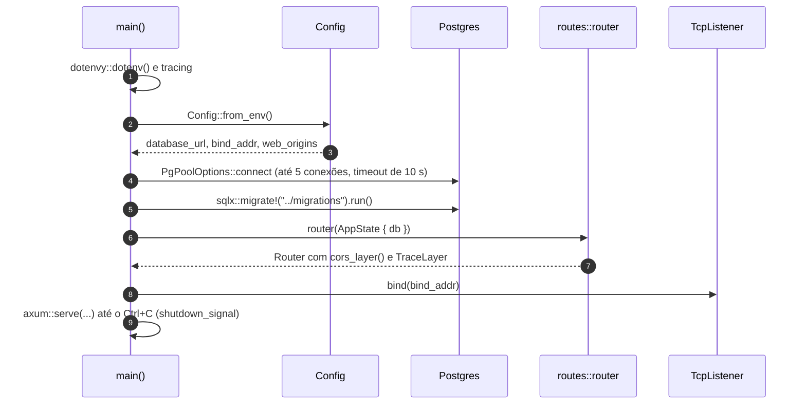
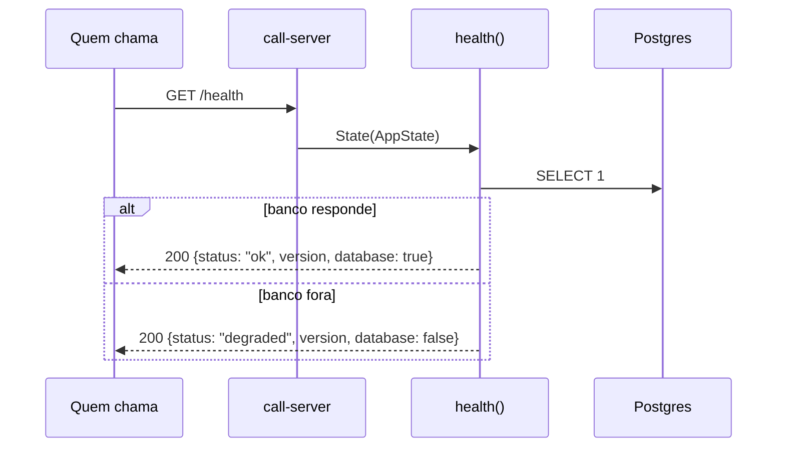

# Fluxos

## Subida do servidor

Se faltar o `DATABASE_URL`, se o Postgres não responder ou se uma migration falhar, o processo
termina com erro antes de abrir a porta.

## `GET /health`

Usado para conferir se a API e o banco estão de pé (e, na Fase 3, pelo monitoramento). O client
não chama mais essa rota: o fluxo dele começa no refresh da sessão ([08-client.md](08-client.md)).

