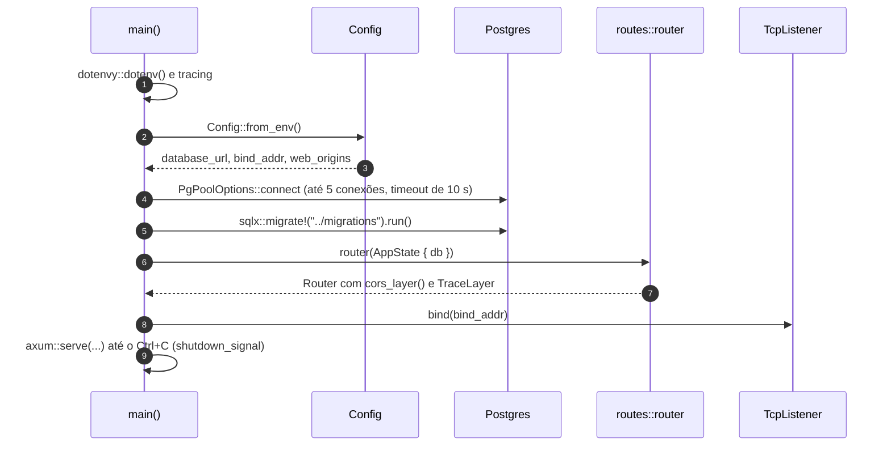
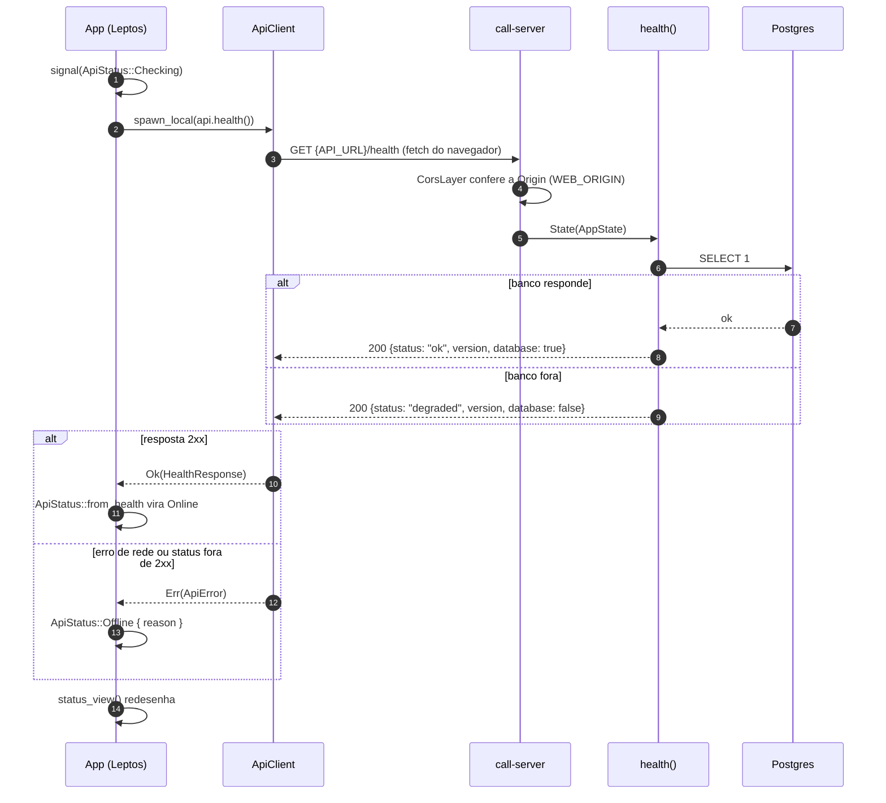
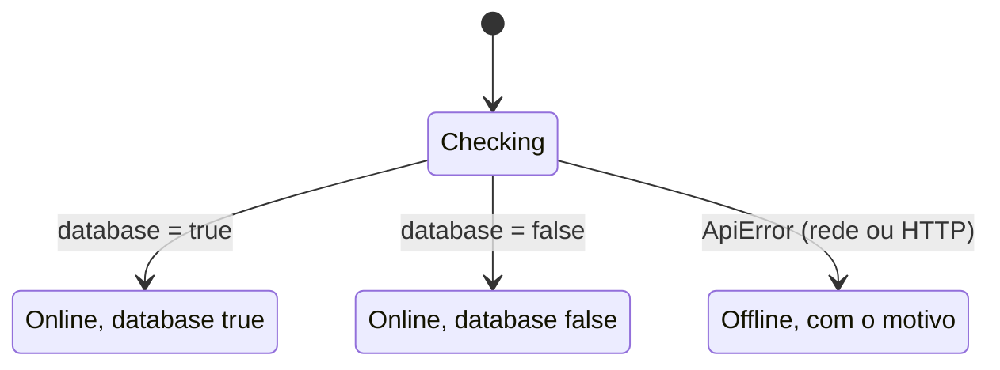

# Fluxos

## Subida do servidor

Se faltar o `DATABASE_URL`, se o Postgres não responder ou se uma migration falhar, o processo
termina com erro antes de abrir a porta.

## `GET /health` de ponta a ponta

É o único fluxo completo hoje, e já percorre o caminho que a Fase 1 vai usar: Leptos,
`api-client`, CORS, axum, Postgres, tipos do `proto` e de volta à UI.

## Estados da tela

| Estado | Texto na tela |
| --- | --- |
| `Checking` | "Verificando a API..." |
| `Online { database: true }` | "API online (vX), banco conectado" |
| `Online { database: false }` | "API online (vX), mas sem banco" |
| `Offline { reason }` | "API indisponível: ..." |

Hoje a checagem roda uma vez só, quando a página monta. Não há nova tentativa.
