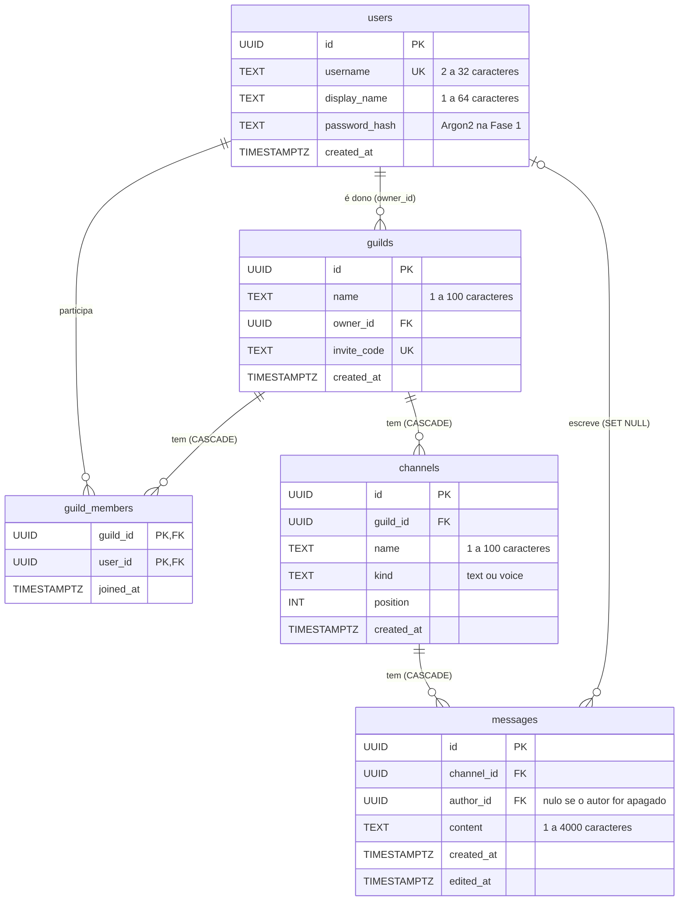

# Banco de dados

Este é o esquema da migration `migrations/20261121000000_init.sql`. As tabelas já são criadas na
subida do servidor, mas nenhum código as usa ainda: elas entram na Fase 1. Os IDs são UUIDv7
gerados pela aplicação e correspondem aos tipos `UserId`, `GuildId`, `ChannelId` e `MessageId`
do `proto`.

## Índices

| Índice | Para que serve |
| --- | --- |
| `guild_members_user_idx (user_id)` | Listar os servidores de um usuário |
| `channels_guild_idx (guild_id, position)` | Listar os canais de um servidor em ordem |
| `messages_channel_idx (channel_id, id DESC)` | Paginação `?before=<id>` do histórico. Funciona porque o UUIDv7 é ordenável por tempo |

## Observações

- Apagar um servidor (guild) apaga em cascata os membros, os canais e as mensagens. Apagar um
  usuário mantém as mensagens dele, com `author_id` nulo.
- Apagar o usuário dono de um servidor falha, porque `guilds.owner_id` não tem `ON DELETE`.
  Defina o comportamento na Fase 1 (transferir o servidor ou bloquear a exclusão).
- Ainda não há tabela para o refresh token rotativo da Fase 1. Ela precisa de uma migration nova.
