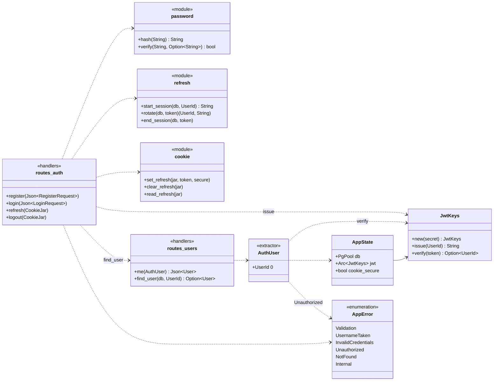
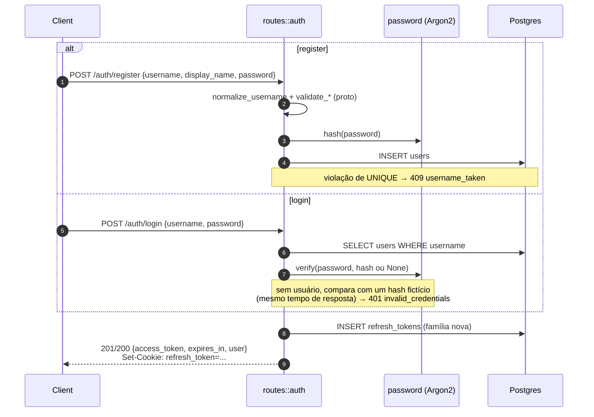
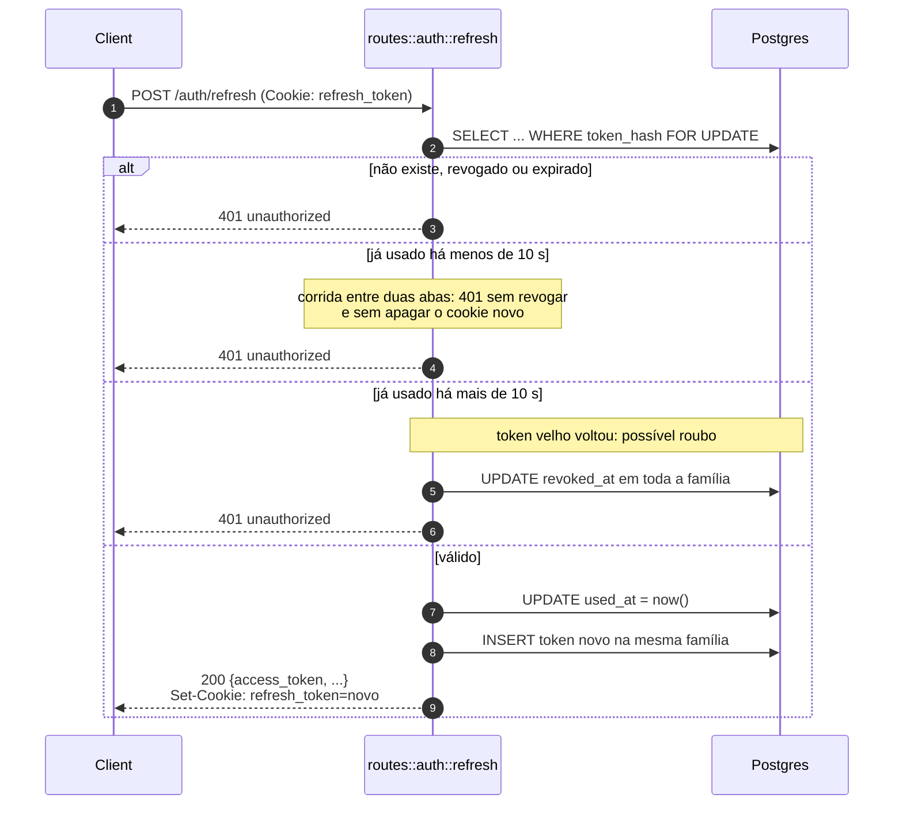
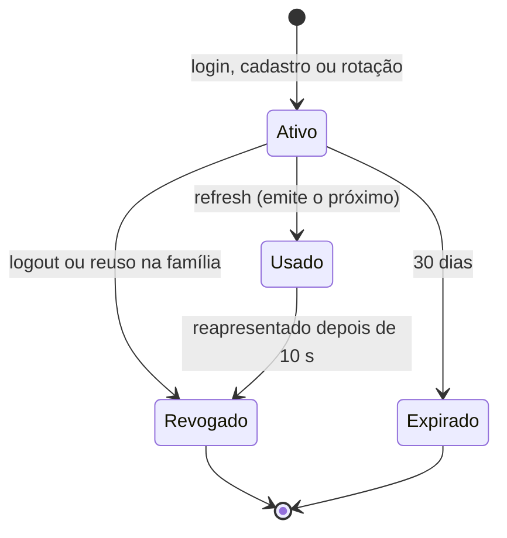

# Autenticação

Implementada no servidor na Fase 1. O client ainda não usa.

- **Access token:** JWT HS256 válido por 15 min, com `sub` = id do usuário. Vai no corpo da
  resposta e volta como `Authorization: Bearer`.
- **Refresh token:** 256 bits aleatórios, válido por 30 dias, num cookie `HttpOnly`, `SameSite=Lax`
  e `Path=/auth`. O banco guarda só o SHA-256 dele.
- **Senha:** Argon2id, executado fora do runtime async (`spawn_blocking`).

## Módulos do servidor

O `AppError` vira uma resposta `proto::ErrorResponse { code, message }`. Os erros internos vão
para o log, e o client recebe só "erro interno do servidor".

## Cadastro e login

## Refresh com rotação e detecção de reuso

## Estados de um refresh token

