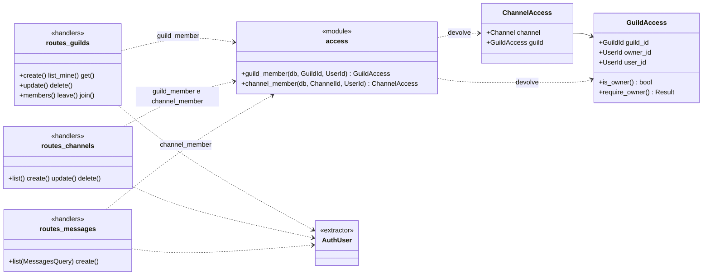
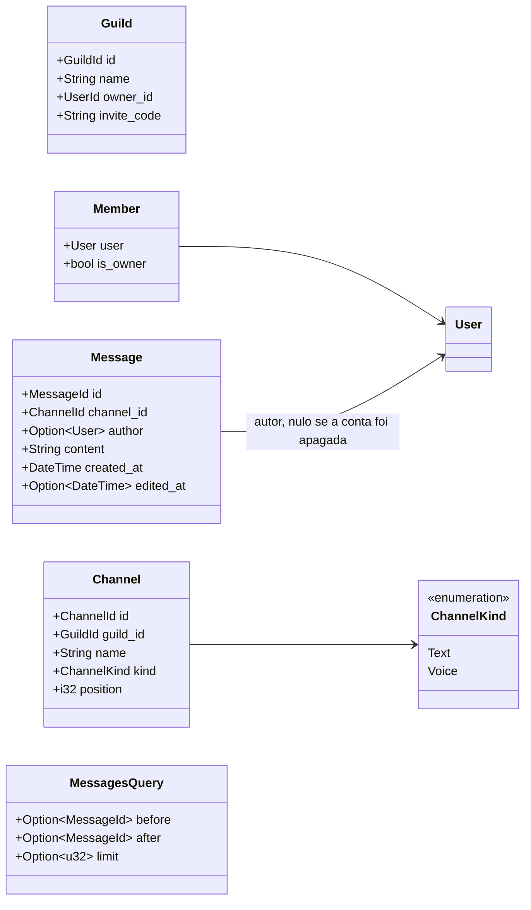

# Servidores, canais e mensagens

Implementado no servidor na Fase 1. O client ainda não usa. Todas as rotas exigem
`Authorization: Bearer`.

## Rotas

| Rota | Quem pode | O que faz |
| --- | --- | --- |
| `POST /guilds` | Qualquer usuário | Cria o servidor com os canais `geral` (texto) e `Geral` (voz). Responde 201 |
| `GET /users/@me/guilds` | O próprio usuário | Servidores de que participa, na ordem em que entrou |
| `GET /guilds/{id}` | Membro | O servidor, com o código de convite |
| `PATCH /guilds/{id}` | Dono | Renomeia |
| `DELETE /guilds/{id}` | Dono | Apaga, com canais e mensagens. Responde 204 |
| `GET /guilds/{id}/members` | Membro | Membros, com a marca de dono |
| `DELETE /guilds/{id}/members/@me` | Membro que não é dono | Sai do servidor. Responde 204 |
| `POST /invites/{code}` | Qualquer usuário | Entra no servidor. Repetir não dá erro |
| `GET /guilds/{id}/channels` | Membro | Canais, ordenados por `position` |
| `POST /guilds/{id}/channels` | Dono | Cria um canal no fim da lista. Responde 201 |
| `PATCH /channels/{id}` | Dono | Renomeia |
| `DELETE /channels/{id}` | Dono | Apaga, com as mensagens. Responde 204 |
| `GET /channels/{id}/messages` | Membro | Histórico de um canal de texto (veja a paginação) |
| `POST /channels/{id}/messages` | Membro | Grava uma mensagem num canal de texto. Responde 201 |

Quem não é membro recebe **404**, e não 403, para não revelar que o servidor ou o canal existe.
Um membro que tenta uma ação de dono recebe **403** com `code: "forbidden"`.

O envio de mensagens é por REST. O WebSocket vai só distribuir aos inscritos o
`MESSAGE_CREATE` de cada mensagem gravada.

## Paginação do histórico

`GET /channels/{id}/messages?before=<id>|after=<id>&limit=50`. O `limit` vai de 1 a 100, e o
padrão é 50. A resposta vem sempre em ordem cronológica, da mais antiga para a mais nova.

| Query | Devolve | Uso no client |
| --- | --- | --- |
| Sem cursor | As `limit` mais recentes | Abrir o canal |
| `before=<id>` | As `limit` imediatamente anteriores | Rolar o histórico para cima |
| `after=<id>` | As `limit` imediatamente posteriores | Recuperar o que perdeu ao reconectar |

Os cursores funcionam porque o UUIDv7 é ordenável por tempo. Mandar `before` e `after` juntos
dá 422.

## Módulos do servidor

O módulo `access` é a única porta de permissão: os handlers não escrevem a checagem de membro
à mão. O `SUBSCRIBE` do WebSocket e o token de voz da Fase 2 vão usar o mesmo `channel_member`.

## Tipos do contrato (`proto`)

Os corpos de entrada são `CreateGuildRequest`, `UpdateGuildRequest`, `CreateChannelRequest`,
`UpdateChannelRequest` e `CreateMessageRequest`. As regras (`validate_guild_name`,
`validate_channel_name` e `validate_message_content`) ficam no `proto`, para o client validar
igual ao servidor.

O código de convite tem 8 caracteres de um alfabeto sem `0`, `O`, `1`, `l` e `I`. Se ele colidir
com um existente, o servidor tenta de novo com outro.
