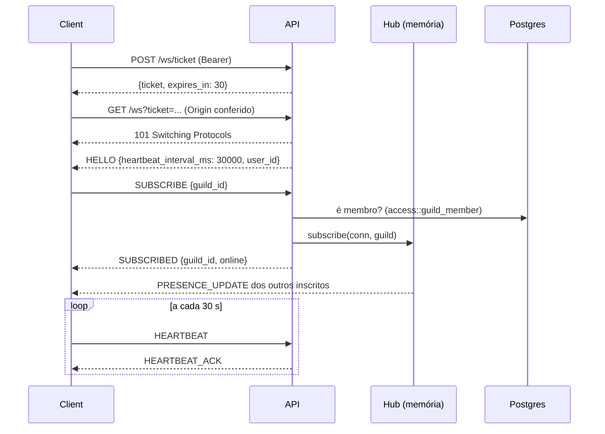
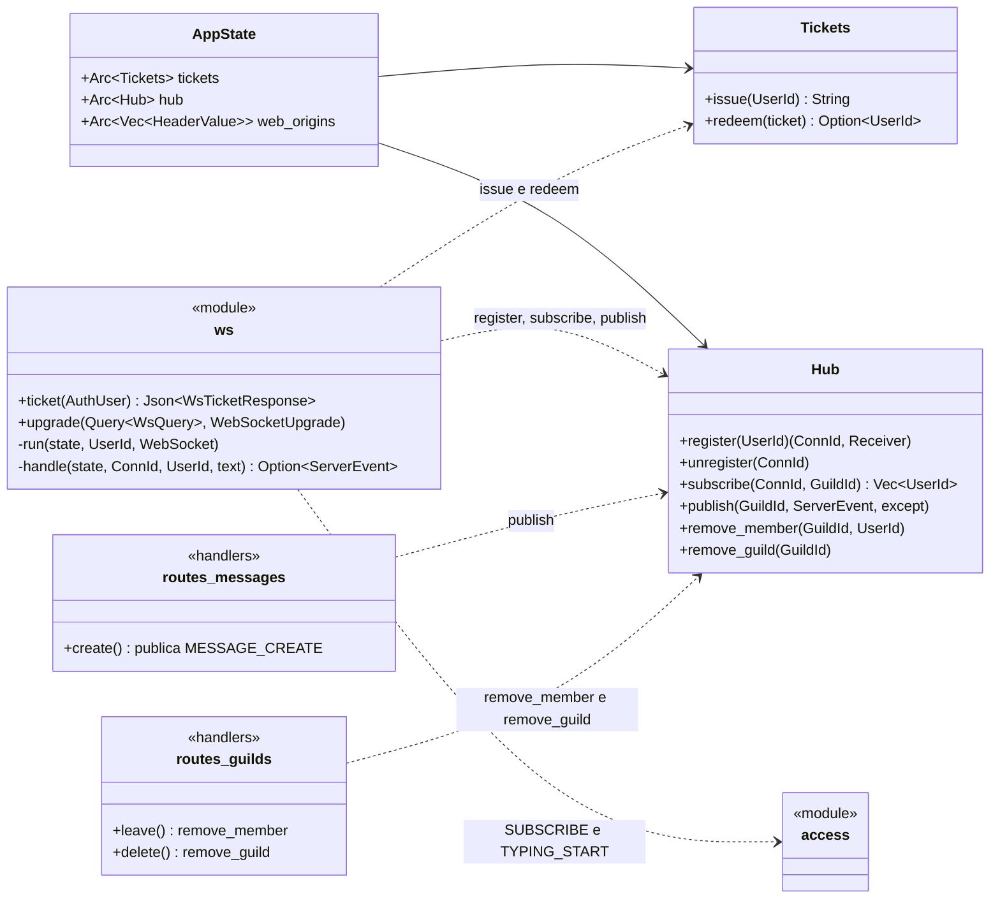

# WebSocket do chat

Implementado no servidor na Fase 1. O client ainda não usa. O código está em `server/src/ws/`, e
o contrato, em `crates/proto/src/ws.rs`.

## Conexão

O navegador não manda `Authorization` no upgrade do WebSocket, e um JWT na URL vazaria para os
logs. Por isso o client troca o access token por um **ticket de uso único, válido por 30 s**.

- **Ticket:** `GET /ws` sem ticket válido responde 401, e um ticket já usado também.
- **Origin:** um `Origin` fora de `WEB_ORIGIN` responde 403, porque CORS não protege
  WebSocket. Um client fora do navegador não manda `Origin` e passa só pelo ticket.
- **Heartbeat:** sem nenhuma mensagem do client por 60 s (duas vezes o intervalo), o servidor
  fecha a conexão.

## Eventos

Formato no fio: `{"t": "<TIPO>", "d": {...}}`.

| Do client | Dados | Efeito |
| --- | --- | --- |
| `HEARTBEAT` | | Responde `HEARTBEAT_ACK` |
| `SUBSCRIBE` | `guild_id` | Passa a receber os eventos do servidor. Quem não é membro recebe `ERROR not_found` |
| `TYPING_START` | `channel_id` | Avisa os outros inscritos. Mande de novo a cada ~8 s enquanto digita |

| Do servidor | Dados | Quando |
| --- | --- | --- |
| `HELLO` | `heartbeat_interval_ms`, `user_id` | Logo após o upgrade |
| `HEARTBEAT_ACK` | | Resposta ao `HEARTBEAT` |
| `SUBSCRIBED` | `guild_id`, `online` | Resposta ao `SUBSCRIBE`, com quem está online no servidor |
| `MESSAGE_CREATE` | a `Message` inteira | Depois de `POST /channels/{id}/messages` gravar a mensagem |
| `TYPING_START` | `guild_id`, `channel_id`, `user_id` | Alguém começou a digitar |
| `PRESENCE_UPDATE` | `guild_id`, `user_id`, `status` | Alguém ficou `online` ou `offline` no servidor |
| `ERROR` | `code`, `message` | Um evento do client foi recusado. A conexão continua aberta |

O envio de mensagens é por REST, e não pelo WebSocket. A mensagem é gravada antes de ser
difundida, então quem reconecta acha no histórico (`?after=<último id>`) tudo o que perdeu.

## Inscrição por servidor e presença

O plano previa um `broadcast` por canal de texto. A implementação inscreve cada conexão por
**servidor** (guild), com uma fila própria por conexão:

- Quem sai do servidor (`DELETE /guilds/{id}/members/@me`) deixa de receber os eventos dele na
  hora, sem reconectar. Apagar o servidor tira todos os inscritos.
- Um canal criado depois já entra na inscrição.
- **Presença:** um usuário está online num servidor enquanto tiver ao menos uma conexão inscrita
  nele. Uma segunda aba não repete o `online`; o `offline` só sai quando a última fecha.
- **Conexão lenta:** se a fila de uma conexão encher (256 eventos), o hub a desliga. O client
  reconecta e recarrega o histórico.

O hub é em memória e só funciona com **uma instância** do servidor. Para escalar
horizontalmente, troque o `Hub` por Redis pub/sub ou NATS mantendo a mesma interface.
