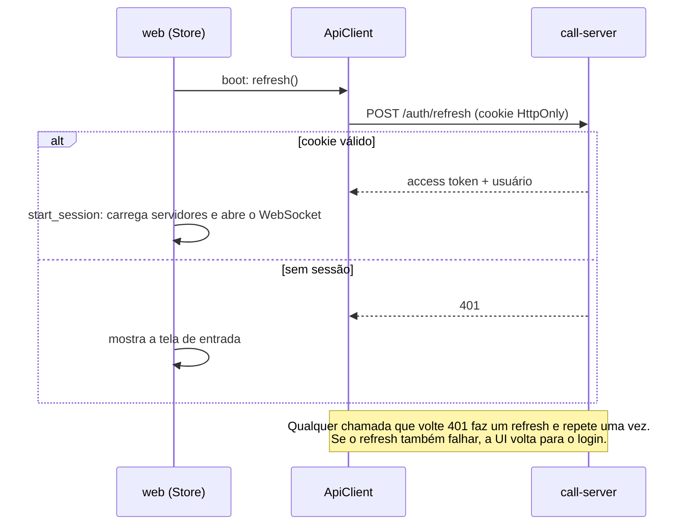
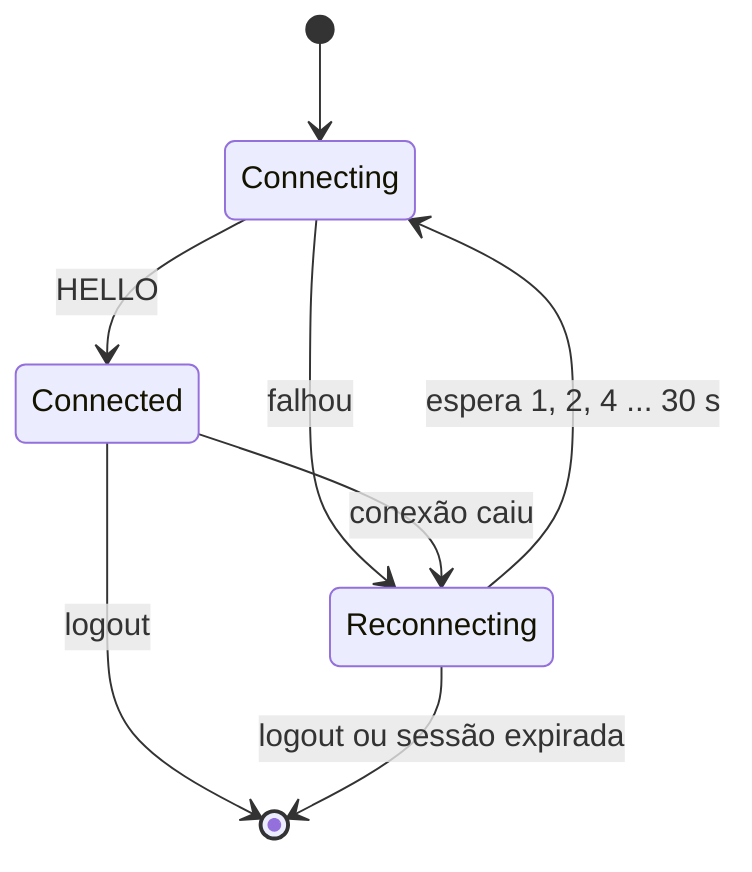

# Client (Leptos)

O client roda no navegador, compilado para WebAssembly com o Trunk. Ele tem três crates:

| Crate | O que tem |
| --- | --- |
| `api-client` | `ApiClient` com todas as rotas REST, o refresh automático e a conexão WebSocket (`ws::connect`, só em wasm32) |
| `call-core` | Lógica sem UI e testada sem navegador: `MessageLog`, `Typing`, `Backoff` e `ConnState` |
| `web` | Os sinais do Leptos (`Store`), o loop do WebSocket (`gateway`) e as telas (`views`) |

## Sessão



- **Access token:** fica só na memória do `ApiClient`. O refresh token fica no cookie
  `HttpOnly`, que o JavaScript não lê. Por isso toda chamada vai com `credentials: include`.
- **URL da API:** sem `CALL_API_URL` no build, o client usa o mesmo host da página na porta 3000.
  O host precisa bater, porque o navegador trata `localhost` e `127.0.0.1` como sites diferentes
  e aí não manda o cookie de refresh.
- **Uma sessão por navegador:** o cookie é um só. Para testar com dois usuários, use dois
  navegadores ou uma janela anônima.

## WebSocket e reconexão



Ao receber o `HELLO` (`Store::on_connected`), o client:

1. manda `SUBSCRIBE` para cada servidor da lista;
2. busca em cada canal já aberto o que chegou depois da última mensagem
   (`?after=<id>`, de 100 em 100);
3. recarrega a lista de membros, para incluir quem entrou enquanto a conexão estava caída.

Quando a conexão cai, a presença é zerada, porque não dá para saber quem está online. A espera
entre tentativas dobra até 30 s, com até 25 % a mais de jitter, e volta a 1 s ao conectar.
O heartbeat sai a cada `heartbeat_interval_ms` do `HELLO`.

O logout muda o `epoch` do `Store`. Toda tarefa de uma sessão (o loop do WebSocket, o heartbeat
e o relógio) confere o `epoch` e para quando ele muda, e a fila de saída é fechada, o que fecha
o socket.

## Mensagens

Uma mensagem chega por três caminhos que se sobrepõem: a página inicial do histórico, o
`MESSAGE_CREATE` e a recarga depois de reconectar. O `MessageLog` junta tudo em ordem de id
(UUIDv7), sem duplicar.

- O envio é por `POST`. A resposta já entra no log, e o eco do WebSocket não duplica.
- "Carregar mensagens antigas" busca `?before=<mais antiga>` e mantém a posição de leitura.
- A lista desce sozinha numa mensagem nova se você já estava no fim. Se você subiu para ler o
  histórico, ela fica onde está.
- **Digitação:** o client manda `TYPING_START` no máximo a cada 7 s enquanto você digita, e
  mostra o aviso dos outros por 8 s, ou até chegar a mensagem da pessoa.
- **Membros:** uma mensagem de um autor que ainda não está na lista recarrega os membros. É o
  caso de quem entrou pelo convite mas nunca abriu o WebSocket.

```mermaid
classDiagram
    direction LR

    class Store {
        <<signals>>
        +me, guilds, channels, members
        +online, logs, unread, typing
        +selected_guild, selected_channel, conn
        +boot() start_session() logout()
        +select_guild() select_channel() load_older()
        +send_message() create_guild() join_invite()
        +on_connected() on_disconnected() apply(ServerEvent)
    }
    class gateway {
        <<module>>
        +spawn(Store, epoch)
    }
    class ApiClient {
        +refresh() login() register() logout()
        +my_guilds() channels() members() messages()
        +send_message() ws_ticket()
    }
    class MessageLog
    class Typing
    class Backoff
    class views {
        <<components>>
        AuthPage
        ChatPage, GuildBar, ChannelSidebar
        MessagePane, Composer, MemberList
    }

    views ..> Store : lê sinais e chama ações
    Store ..> ApiClient
    Store --> MessageLog : um por canal aberto
    Store --> Typing
    gateway ..> Backoff
    gateway ..> Store : apply e on_connected
    gateway ..> ApiClient : ws::connect
```
