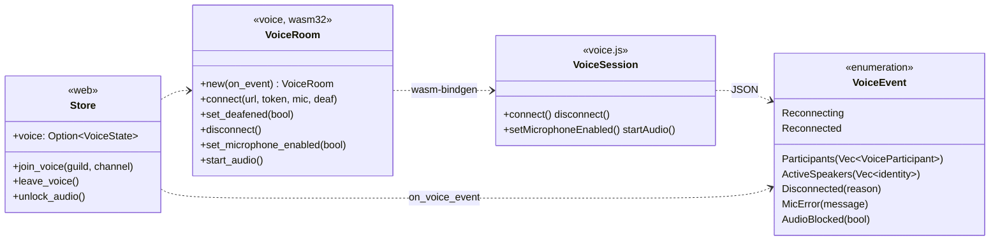

# Voz

Fase 2, em andamento. O áudio nunca passa pelo call-server: ele só confere a permissão e assina
um token, e o client conecta direto ao LiveKit (SFU) por WebRTC.

## Token de entrada

```mermaid
sequenceDiagram
    participant C as Client
    participant A as call-server
    participant DB as Postgres
    participant LK as LiveKit
    C->>A: POST /channels/{id}/voice/token (Bearer)
    A->>DB: é membro do servidor do canal? (access::channel_member)
    A->>A: canal é de voz? assina o JWT com LIVEKIT_API_SECRET
    A-->>C: {url, token, expires_in: 300}
    C->>LK: conecta em url com o token (WebRTC)
    LK->>LK: confere a assinatura; cria a sala se for o primeiro
```

| Campo do token | Valor | Por quê |
| --- | --- | --- |
| `sub` (identidade) | id do usuário | O LiveKit identifica o participante, e os webhooks dizem quem entrou |
| `name` | nome de exibição | Para a UI mostrar quem está na sala |
| `video.room` | id do canal de voz | Uma sala do LiveKit por canal |
| `room_join`, `can_subscribe` | sim | Entrar e ouvir os outros |
| `can_publish` com `can_publish_sources = ["microphone"]` | só o microfone | O MVP é só áudio: sem câmera nem tela |
| `can_publish_data`, `can_update_own_metadata` | não | Nada além do áudio passa pelo LiveKit |
| `room_config.max_participants` | 10 | Vale quando esta entrada cria a sala |
| validade | 5 min | Só precisa durar até conectar; depois o LiveKit renova sozinho |

Recusas: quem não é membro recebe **404**; canal de texto recebe **422**; sem login, **401**.

O token é assinado localmente com a crate `livekit-api` (features `access-token` e `webhooks`,
sem o cliente HTTP dela). Configuração: `LIVEKIT_URL` (a URL que os clients usam),
`LIVEKIT_API_KEY` e `LIVEKIT_API_SECRET`. Em desenvolvimento, o `livekit-server --dev` do
`docker compose` usa `devkey` e `secret`.

**Endereço da mídia:** o LiveKit anuncia para o WebRTC o IP de `--node-ip`, lido de
`LIVEKIT_NODE_IP` no `.env`. Em desenvolvimento, use o IP da máquina na rede local. O Firefox
não aceita candidatos ICE de loopback: com `127.0.0.1`, a sinalização conecta, mas a mídia fica
em `checking` até falhar. Em produção (Fase 3), é o IP público da VM ou o LiveKit Cloud.

## Ponte com o `livekit-client`

O SDK Rust do LiveKit depende do libwebrtc nativo e não compila para WASM. A voz usa o WebRTC
do navegador (ou do WebView2 no Tauri) pelo SDK JavaScript, numa ponte em três camadas:

| Camada | Arquivo | O que faz |
| --- | --- | --- |
| SDK | `web/vendor/livekit-client-2.25.0.umd.js` | O `livekit-client` oficial (global `LivekitClient`), guardado no repositório e conferido pelo hash do npm (`web/vendor/README.md`) |
| Ponte JS | `crates/voice/js/voice.js` | Classe `VoiceSession` (global `CallVoice`): o único código que conhece a API do LiveKit. Emite eventos em JSON `{"t", "d"}` |
| Ponte Rust | `crates/voice/src` | `VoiceRoom` (`connect`, `disconnect`, `set_microphone_enabled`, `set_deafened`, `switch_input`, `switch_output`, `start_audio`), `list_devices` e `VoiceEvent`, tipados |

Os dois arquivos JS entram pelo `web/index.html` como `<script data-trunk>`, e o Trunk põe o hash
do conteúdo no nome de cada um. A ponte não é um "snippet" do wasm-bindgen
(`#[wasm_bindgen(module = ...)]`) de propósito: a URL de um snippet não muda quando o conteúdo
muda, e um navegador com a versão antiga em cache recusava a nova pela integridade (SRI), e o
app abria em branco.



## Chamada no client

- **Entrar:** clicar num canal de voz pede o token, conecta e abre o microfone. Se já estiver
  noutro canal, sai dele antes. Uma chamada por vez.
- **Microfone negado ou ausente:** a pessoa continua na sala só ouvindo, com um aviso.
- **Áudio dos outros:** cada faixa remota toca num `<audio>` escondido, marcado com a
  identidade do participante e removido quando a faixa ou a pessoa sai.
- **Bloqueio de som do navegador:** se a reprodução automática for bloqueada, aparece o botão
  "Ativar som".
- **Sala:** abaixo do canal aparecem quem está nele, com o anel verde de quem está falando
  (`ActiveSpeakers`) e o ícone de microfone fechado.
- **Sair:** o botão "Sair" do painel de voz, sair da conta, sair do servidor ou fechar a aba.
  Ao fechar a aba ou navegar para outra página, o SDK avisa o LiveKit no `pagehide` e a saída é
  imediata. Se a página morrer sem esse evento (processo encerrado, queda de rede), o LiveKit só
  percebe pela conexão, em uns 20 s.
- **Mute e deaf** (`call_core::VoiceControls`, regras do Discord): o mute fecha só o
  microfone; o deaf silencia os outros para você e também fecha o microfone, lembrando se você
  já estava mutado; desmutar em deaf sai do deaf. Os botões ficam no painel do usuário e valem
  dentro e fora de uma chamada (dá para entrar já mutado, sem nem abrir o microfone). Atalhos:
  Ctrl+Shift+M e Ctrl+Shift+D. O estado fica no `localStorage` do navegador.
- **Dispositivos:** o botão ⚙ do painel do usuário abre a escolha do microfone e da saída de
  áudio, que valem na hora, inclusive no meio da chamada (`room.switchActiveDevice`), e ficam
  guardadas no navegador. "Padrão do sistema" é a primeira opção. Um dispositivo salvo que sumiu
  (headset desconectado) cai no padrão sem erro, e volta a valer quando reaparece: o LiveKit pede
  o dispositivo como `exact`, então a ponte confere a lista antes. Sem a permissão do microfone,
  o navegador esconde os nomes, e a janela pede a permissão. A saída só aparece onde o navegador
  deixa escolher (`setSinkId`); no Safari, por exemplo, o som sai pelo padrão do sistema.
- **Quem vê o quê:** o mute aparece para os outros na hora, pelo próprio LiveKit (a faixa do
  microfone fica mutada). O deaf, por enquanto, só aparece para você: o estado de voz para os
  outros chega pelo WebSocket na etapa do webhook.
- **Detecção de voz:** o microfone fica aberto com o cancelamento de eco, a supressão de ruído
  e o controle de ganho do navegador, e o anel verde usa os `ActiveSpeakers` do LiveKit.
- **Sessão de voz numerada:** cada entrada incrementa um número; eventos de uma sala antiga que
  ainda está fechando são ignorados.

Por enquanto, quem está numa sala só é visível para quem também está nela. O mapa de voz para
todos os membros chega com o webhook do LiveKit.

## Próximas etapas

- Teste em redes diferentes (4G e Wi-Fi de outra casa).
- Webhook do LiveKit e o estado de voz difundido pelo WebSocket do chat.
